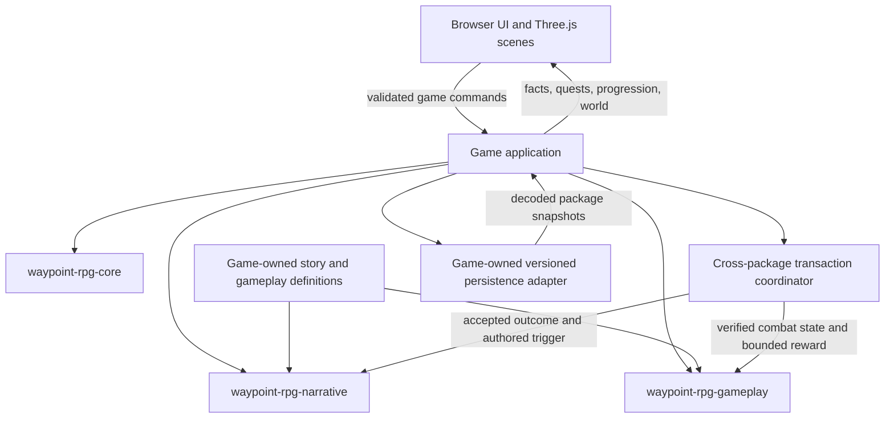

# Creating a sample game with Waypoint RPG

This guide documents the APIs present in the current checkout. A new game owns
its world, narrative, gameplay definitions, renderer, user interface, cross-
package policy, and persistence adapter. It installs the optional framework
packages for generic state-machine behavior.

## Package ownership

| Package                  | Reusable behavior                                                                                                                                               | Game-owned behavior                                                                                                 |
| ------------------------ | --------------------------------------------------------------------------------------------------------------------------------------------------------------- | ------------------------------------------------------------------------------------------------------------------- |
| `waypoint-rpg-core`      | `createGameRuntime`, world/map/anchor types, navigation graphs, pathfinding, generic persistence contracts                                                      | Application state and commands, movement rules, arrival and interaction checks, browser storage                     |
| `waypoint-rpg-narrative` | Definition validation/compilation, typed conditions and effects, dialogue, quest transitions, replay protection, snapshot decoding and selectors                | Characters, quests, dialogue text, trigger eligibility, narrative-to-world policy                                   |
| `waypoint-rpg-gameplay`  | Progression, experience, inventory, equipment, derived attributes, abilities, statuses, deterministic tactical combat, rewards, outcome markers, snapshot codec | Items and combat definitions, encounter eligibility, trusted rewards, UI, mapping combat outcomes into story events |



The packages have no dependency on one another. A game may install only the
ones it uses. None includes a renderer, story, browser UI, or browser-storage
implementation. Do not import package internals or copy package algorithms
into a sample.

The production reference at the repository root, [محله مهربانی](MAHALLE-LIBRARY-ADOPTION.md),
demonstrates all three packages with a child-specific interaction contract:
core hosts its runtime and navigation, narrative owns the replayable quest
history, and gameplay owns generic deterministic one-on-one battle transitions.
The game keeps physical choices, profile saves, and its renderer in application
code. Use it to understand package boundaries, but build a new game's state
adapter and authored content from this guide instead of importing its private
source files.

## Generate a portable starting project

Install the creator CLI and package the framework roots that the new game will
use. The core is mandatory; narrative and gameplay are selected independently.
The command requires a local tarball for each selected package and copies those
archives into the new project's `vendor/` folder:

```sh
npm pack --ignore-scripts --workspace=packages/core --pack-destination ./archives
npm pack --ignore-scripts --workspace=packages/narrative --pack-destination ./archives
waypoint-rpg game create --directory "./games/Blood Leaf" --id blood-leaf \
  --name "Blood Leaf" --packages core,narrative \
  --core-tarball ./archives/waypoint-rpg-core-0.1.0.tgz \
  --narrative-tarball ./archives/waypoint-rpg-narrative-0.1.0.tgz
waypoint-rpg game validate "./games/Blood Leaf"
waypoint-rpg game inspect "./games/Blood Leaf"
```

The generated `game.project.json` is versioned and game-owned. It declares the
public framework package roots, scene/map/start anchor, asset catalog and
runtime asset records, content references, locales, accessibility settings,
save namespace/schema, and fixed npm script names. Timeline references remain
disabled until their runtime API is independently verified. Manifest paths use
portable forward slashes and must stay inside the game project. Creation does
not overwrite an existing destination.

The starter contains one actual R3F scene with an application-owned reducer,
touch-sized DOM control, unit test, and Playwright screenshot test. It does not
copy Garden or scene-demo internals. The starter toolchain (React/R3F, Vite,
TypeScript, Vitest, and Playwright) is development tooling; the framework
packages remain separate runtime dependencies. The generated lockfile pins its
local framework archives and toolchain. With the required package bytes in npm's
cache, install/build/test without a network connection:

```sh
cd "./games/Blood Leaf"
npm ci --offline
npm run build
npm test
npm run capture
```

The generated `package.json` refers to `vendor/waypoint-rpg-*.tgz` rather than
workspace links. The sample owns its story and state transitions. For a
narrative-only project omit gameplay; for a tactical project select the
gameplay package without importing narrative unless the game needs it.

To verify the generated-project boundary, run
`npm run framework:generated-games`. This focused gate generates narrative-only
and tactical-only projects outside the repository, installs the creator and
selected package archives offline from the prepared tool cache, imports shared
and game-local catalog assets, rejects deep/workspace imports, checks package
declarations with NodeNext and Bundler, and runs each app's unit, build, save,
and Chromium acceptance tests. It saves source-rendered reference images under
`docs/previews/creator/`. The fixtures are tool tests rather than portfolio
games or release-approved content.

## Compose one authoritative runtime

Import the package roots and keep committed game state in one application-owned
reducer hosted by core:

```ts
import { createGameRuntime, findPath } from 'waypoint-rpg-core';
import type { AnchorId } from 'waypoint-rpg-core';

interface GameState {
  readonly mapId: 'village' | 'garden';
  readonly anchorId: AnchorId;
  readonly narrative: NarrativeState;
  readonly gameplay: GameplayState;
}

const runtime = createGameRuntime<GameState, GameCommand>({
  createInitialState: createInitialGame,
  reducer: reduceGameCommand,
});
```

The core runtime provides state access, dispatch, subscription, and disposal;
it does not make game decisions or access storage. A path found by `findPath`
does not prove that the player arrived. The application commits arrival
commands and checks current map, exact anchor, interaction owner, and any
required quest facts before an interaction can cause an effect.

`examples/garden-adventure/src/game/runtime.ts` shows an application-owned
coordinator for narrative and gameplay snapshots. UI components dispatch
commands and read selectors; they do not mutate package state directly.

## Author narrative content

Keep stable dialogue, node, choice, quest, trigger, fact, and ending IDs with
the game. Validate and compile the authored `NarrativeDefinition`; create one
state with the same playthrough ID used by compatible package states:

```ts
import {
  compileNarrative,
  createNarrativeState,
  getDialogueView,
  getFact,
  getQuestStatus,
  transitionNarrative,
  validateNarrative,
} from 'waypoint-rpg-narrative';

const report = validateNarrative(storyDefinition);
if (!report.ok) throw new Error('Fix story definition diagnostics first.');
const story = compileNarrative(storyDefinition);
let narrative = createNarrativeState(story, playthroughId);

const result = transitionNarrative(story, narrative, {
  type: 'open-dialogue',
  dialogueId: storyDefinition.entryDialogueId,
  playthroughId: narrative.playthroughId,
  expectedRevision: narrative.revision,
});
if (result.accepted) narrative = result.state;

const dialogue = getDialogueView(story, narrative, 'fa');
const questStatus = getQuestStatus(story, narrative, 'quest-id');
const fact = getFact(narrative, 'world-change');
```

Supported commands include `open-dialogue`, `choose`, `advance`,
`exit-dialogue`, `finish`, and `trigger`. Each uses the current playthrough ID
and expected revision. Use `decodeNarrativeState` to validate restored data.
Only replace the snapshot after an accepted transition. Trigger effects are
authored data; location, target ownership, and command eligibility are still
application policy.

## Author gameplay and render package state

Define characters, attributes/resources, items, equipment, abilities, status
effects, boards, encounters, rewards, and outcome mappings as a
`GameplayDefinition`. Validate and compile it once. The public package APIs
include:

- `createGameplayState`, `transitionGameplay`, and trusted `applyGameplayGrant`
- `getCharacterLevel`, `getCharacterAttributes`,
  `getEffectiveCharacterAttributes`, `getUnlockedAbilityIds`, and
  `getInventorySlotCount`
- `encodeGameplayState` and `decodeGameplayState`

The package owns progression arithmetic, inventory limits, equipment
eligibility, target/range validation, turn ownership, enemy decisions, status
durations, outcome markers, and reward replay protection. Do not recreate those
rules in React. Author sample-specific definitions and use selectors to render
the results. In Garden, the charm modifier comes from
`getCharacterAttributes`, status-adjusted movement comes from
`getEffectiveCharacterAttributes`, and inventory capacity comes from
`getInventorySlotCount`.

The renderer projects committed facts and gameplay state. For example, Garden
renders a blossoming tree when the narrative `tree-grown` fact is true and a
lit lantern when `lantern-lit` is true. Scene components never complete quests,
grant experience, or resolve combat.

## Coordinate cross-package outcomes transactionally

Do not let a battle UI dispatch an arbitrary narrative trigger or reward grant.
The application reducer should handle a terminal encounter as one combined
state transition:

1. Check the active map, playthrough ID, gameplay revision, and encounter
   instance ID.
2. Pass the player intent to `transitionGameplay`.
3. For a terminal accepted result, find the package-authored outcome marker and
   verify its consequence against the compiled encounter's outcome mapping.
4. Map only that known consequence ID to a predefined narrative trigger.
5. Run `transitionNarrative` with the current narrative revision.
6. Commit both resulting snapshots together only if every step succeeds.

If narrative rejects the event, return the original combined application
state. This prevents a saved victory without its story consequence or a story
ending without a verified encounter. Stable encounter instance IDs, each
package revision, playthrough identity, and package replay guards reject stale
or duplicate commands. Garden's `applyBattleAction` implements this boundary.

## Own persistence and recovery

Packages never read browser storage. Define a game-owned envelope containing a
schema version, compatibility metadata, playthrough identity, current map and
anchor, narrative snapshot, and `encodeGameplayState` output. Restore through
`decodeNarrativeState` and `decodeGameplayState`, verify cross-package
consistency, then dispatch a plain restore command. Never serialize compiled
indexes, Three.js objects, UI state, or renderer resources.

Garden stores its envelope under the isolated key
`waypoint-rpg:garden-adventure:save`. It supports new game, save/continue,
active-combat reload, completed-story reload, reset, and v1-to-v2 migration.
Corrupt or unsupported bytes remain untouched until the player confirms a
reset; browser storage exceptions switch the current session to unsaved mode.

## Build and verify independent packages

Workspace links are useful during development, but they do not prove
independent consumption. Pack each compiled package, install the archives in a
temporary consumer outside the checkout, reject deep imports, resolve root
ESM and TypeScript declarations, build the application, and run its browser
smoke. Garden's three-package gate is:

```bash
npm run framework:garden-consumer
```

It installs the locked toolchain separately from offline package archives.
Each of the three archives is also installed alone and checked with native
ESM plus TypeScript NodeNext and Bundler resolution. The combined sample is
then type-checked, unit-tested, production-built, and exercised in Chromium.
Offline archive installation does not mean a new Playwright/Vite toolchain can
be downloaded offline.

## Develop, test, and capture

```bash
npm run sample:garden:dev
npm run sample:garden:build
npm run sample:garden:test
npm run sample:garden:e2e
npm run framework:garden-consumer
npm run sample:garden:previews
```

The last command captures the production build in Chromium. It waits for the
scene probe, checks the canvas/camera/mesh state, verifies PNG dimensions and
hashes, and records the capture's source commit. Images are documentation
artifacts, not pixel-perfect regression baselines.
