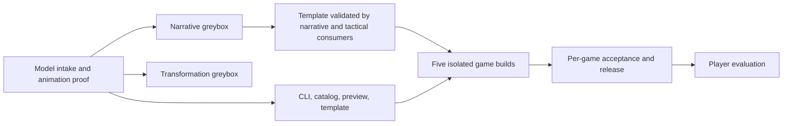

# RPG Framework Product and Release Roadmap

This document defines a proposed five-game portfolio to validate the reusable framework. Titles, stories, audiences, and release order are planning proposals. Approve each product concept and its audience before production content or public release. The Kids RPG, `examples/scene-demo/`, and the existing Garden sample are framework references. They do not count toward the five releases.

## Phase 6 creator workflow status

The repository now has a local creator CLI for GLB/glTF import, a versioned
shared asset catalog with technical readiness separate from game-specific
release approval, a local model preview, and a versioned one-scene project
manifest/scaffold. The independent acceptance gate generates narrative-only
and tactical-only projects outside the workspace using installed package
archives. Both are tooling fixtures, not shipped or approved games. Their
source-rendered Chromium captures are
[narrative-only](previews/creator/generated-narrative-consumer.png) and
[tactical-only](previews/creator/generated-tactical-consumer.png). Phase 7
remains the separate workstream for the five playable products listed below.
The package, preview, and both generated-consumer gates passed locally on
Node.js 22.23.5/npm 10.9.9; the focused CI workflow is ready, but its first
remote Actions result is pending because the Phase 6 branch has not been
published. These fixtures do not count toward the portfolio.

## Portfolio and game specifications

Each sample is a separate build and launchable application with exactly one playable map. Title screens, dialogue, modal interfaces, and alternate camera staging do not add maps. Each game owns its story, runtime policy, save namespace/version, controls, production assets, and release configuration. Keep a short-session target and a complete interaction loop, not a static viewer.

| ID                                                      | Audience and session                                                         | Single-scene game, objective, and end conditions                                                                                                                                                                                     | Framework use, assets, persistence, and acceptance                                                                                                                                                                                                                                                                                          |
| ------------------------------------------------------- | ---------------------------------------------------------------------------- | ------------------------------------------------------------------------------------------------------------------------------------------------------------------------------------------------------------------------------------ | ------------------------------------------------------------------------------------------------------------------------------------------------------------------------------------------------------------------------------------------------------------------------------------------------------------------------------------------- |
| **NARRATIVE — برگ خون (proposed)**                      | Persian readers, teens and adults. 6–10 minutes.                             | In an archive courtyard, meet a keeper and choose investigation or confrontation. Inspect a clue or accept a distinct consequence, then reach one of two endings. Completion records the branch. Restart begins a fresh playthrough. | Core + narrative; no gameplay package required. Shared traveler/keeper rigs and archive props, unique leaf/inscription. Idle and inspect clips. Test both endings, clue gate, resume, restart, Persian RTL, keyboard exit, and scene lifecycle.                                                                                             |
| **TACTICAL — Arena of Embers (working title)**          | New tactics players, teens and adults. 8–12 minutes.                         | Equip one training kit in a single arena and complete a deterministic encounter using movement, range, and one status ability. Victory completes the session. Defeat returns to a safe retry.                                        | Core + gameplay; narrative optional. Reuse humanoid rigs, create unique kit and opponent details. Test player victory, internal enemy-action defeat, turn/reward rollback, mid-combat save, reload, and duplicate-outcome rejection. Release only after Phase 4's gameplay consumer evidence is closed.                                     |
| **PUZZLE — Garden of Stories (new single-map product)** | Casual puzzle players and families, subject to audience review. 5–8 minutes. | Restore a water feature by exploring one connected garden, collecting tools, and activating a sequence of objects. Invalid order gives a gentle retry. Completion visibly restores the fountain.                                     | Core + narrative conditions; gameplay inventory only if the current inventory API materially reduces game-owned code. New one-map scenes and props. Test actual arrival vs reachability, ordered puzzle, state recovery, reload, touch, and keyboard. Existing two-scene Garden sample informs the design but is not copied as the release. |
| **TRANSFORMATION — پر سوخته (proposed)**                | Short fantasy story players, teens and adults. 6–10 minutes.                 | At one hilltop sanctuary, examine symbols and choose how to restore a feather. A committed transformation changes the player presentation and opens an objective within that map. A second choice produces a distinct ending.        | Core + narrative + Phase 5 animation/timeline adapter. Unique shrine/feather and either one validated rig with supported morphs or two validated rigs. Test form transition interruption/skip/reduced motion, reload into committed form, keyboard parity, and no gameplay result from timeline cues.                                       |
| **ACTION — آهن و ماران (working title)**                | Players comfortable with real-time input, teens and adults. 5–8 minutes.     | Cross one forge arena, evade readable hazards, and overcome a symbolic sentinel. Defeat offers a retry. A pre-encounter checkpoint restores on reload.                                                                               | Core and Phase 5 animation. Game-owned action input/enemy logic first. Reuse a humanoid base, create sentinel and forge props. Test input timing, pause/retry/checkpoint, performance, and controller/keyboard support. Consider a separate optional real-time package only after this playable consumer proves a reusable contract.        |

Every specification receives its own approved copy, safety/audience review, content ownership, map definition, persisted-state contract, keyboard/touch design, portrait/desktop layout, release budget, browser matrix, and real browser captures before release. Persian-first DOM is the default where the story supports Persian. Text remains HTML rather than canvas textures.

## Capability matrix and dependency order

| Capability               | Narrative                      | Tactical                                 | Puzzle                      | Transformation            | Action                                                 |
| ------------------------ | ------------------------------ | ---------------------------------------- | --------------------------- | ------------------------- | ------------------------------------------------------ |
| `waypoint-rpg-core`      | Runtime, identifiers, world    | Runtime, world                           | Graph navigation            | Runtime, world            | Runtime, input state                                   |
| `waypoint-rpg-narrative` | Branches, quests, endings      | Verified battle consequence if needed    | Conditions if needed        | Choices and endings       | Optional                                               |
| `waypoint-rpg-gameplay`  | —                              | Progression, inventory, equipment, turns | Inventory only if justified | —                         | — unless a separately gated real-time module is earned |
| Phase 5 Three.js adapter | Static and rigged presentation | Rig and combat action mapping            | Static and rigged props     | Rig/morph and timeline    | Rig and action reaction mapping                        |
| Game-owned               | Story, UI, saves               | Transaction, encounter and save policy   | Puzzle rules and hints      | Form progression and save | Real-time controls and AI                              |

Greybox work can proceed in parallel with P5 on placeholders. The narrative sample is the first release candidate because it can exercise core and narrative without waiting for tactical closure. It still waits for the template, approved assets, and release gates. The tactical product waits for Phase 4 exit evidence. Transformation waits for rig and timeline gates. Puzzle can build on the Garden reference while owning its single map. Action proceeds as a game-owned prototype without blocking the other four.

## Shared asset inventory and readiness

Begin with entries in **specified** status. Advance an asset through **sourced/generated → imported → validated → approved → release-ready**. A status change records reviewer, date, and evidence. Store these fields per asset: stable ID and kind; intended use and consuming games; provider/source URL or private-generation origin; creator and generation metadata where applicable; license text, commercial/redistribution rights, attribution and review; private original and release output paths; SHA-256; pinned conversion tool/version/options; scale/orientation/bounds; geometry, texture, memory, skeleton, morph and clip data; tested fallback; readiness status and reviewer.

| Shared inventory                                                                                                                                                                                          | Per-game unique inventory                                                                                                                                                                                                                                   |
| --------------------------------------------------------------------------------------------------------------------------------------------------------------------------------------------------------- | ----------------------------------------------------------------------------------------------------------------------------------------------------------------------------------------------------------------------------------------------------------- |
| Humanoid base and opponent variants; agreed idle/walk/interact/hit/defeat clip set; ground/foliage modules; crates/signage; reusable material/light presets; locally bundled fonts and interface symbols. | Narrative: archive, keeper variant, leaf and inscription. Tactical: arena, board markers, kit and opponent details. Puzzle: valve, water gate and tools. Transformation: shrine, feather and verified form/morph. Action: forge, hazard props and sentinel. |

Deduplicate assets by visual use and hash before commissioning variants. Keep licensing requirements game-specific. Privately owned generated models must retain their actual ownership/usage terms and must never be labeled CC0 without evidence. Import has no paid API, account, or cloud requirement. Preserve original sources, rights evidence, generated metadata required by provider terms, optimized outputs, and conversion records in approved storage. Meshy, Quaternius, Kenney, Poly Haven, Blender, and other sources are candidates, subject to an asset-by-asset license and visual review.

Only plan a paid generation sprint after both static and rigged intake pass, all five lists are deduplicated, style guides/prompts and ownership recording exist, and the games can integrate output immediately. Estimate credit usage from a small measured pilot: expected accepted assets × measured attempts per accepted asset × provider credits per attempt. Estimate cleanup labor separately. Start with a short subscription if procurement authorizes it. Do not make any subscription a framework prerequisite.

## Game creation, releases, and evaluation

The Phase 6 game manifest should identify game/version, required package roots, scene IDs, player/NPC asset IDs, optional narrative/gameplay modules, locale/accessibility settings, save namespace/schema, and build/test/release commands. Game-specific rules stay in the game. Validate two structurally different applications against the template: narrative-only and tactical. Build both from installed tarballs outside the monorepo, and prove that omitting a package works without stubs or private source imports.

Each game can release independently. The portfolio index links only verified releases and states version, tested browsers/devices, and known limitations. A per-game release requires a complete playthrough, alternate result/retry, save/resume/reset, isolated production build, approved rights and final models, animation fallback, render/memory budget, input/accessibility checks, actual browser screenshots, lifecycle/corruption recovery, deployment smoke, and release notes. Maintain separate artifact, deployment path, storage key, and service-worker scope where used. Keep the Kids RPG deployment and existing four-shard Playwright workflow unchanged.

Extend the existing source-rendered screenshot/gallery workflow with per-game capture scripts and metadata: game ID, release version, source SHA, browser/WebGL configuration, viewport, image dimensions, and PNG SHA-256. Capture from the actual production build using deterministic fixture state. Upload captures even when later gallery work fails. Update generated README sections from canonical docs/scripts only after successful capture. Track the existing screenshot workflow formatting failure from run `45018058155` independently and repair its baseline in a separate scoped change.

Start evaluation without telemetry. Use voluntary ratings, written feedback, and supervised observations appropriate to the approved audience. Completion/replay aggregates need explicit consent and audience review. Do not collect personal data from children. Separate player interest from developer interest in framework technology. After a four-week trial, or longer when evidence is sparse, record one decision per game: **Continue** when completed sessions and voluntary requests support investment; **Revise** when repeated friction prevents completion; **Stop** when a fair release trial shows little demand. Preserve the game as a playable demo after Stop and publish the evidence limits.

## Parallel workstreams and integration ownership

| Workstream             | Owns                                                                        | Handoff contract                                                              |
| ---------------------- | --------------------------------------------------------------------------- | ----------------------------------------------------------------------------- |
| Framework architecture | Package boundaries, public contracts, API review                            | Versioned contract note, consumer proof, compatibility review                 |
| Asset and animation    | Import validation, fixture ownership, Three.js adapter, animation lifecycle | Validated asset IDs, fixture/license record, budgets, lease/disposal behavior |
| Creator tools          | Import CLI, shared catalog, preview, template                               | Versioned manifest, commands, sample consumer fixture                         |
| Five game teams        | One isolated game directory/worktree each                                   | Complete playable loop, save ownership, asset list, acceptance evidence       |
| Integration and QA     | Browser tests, rendered previews, performance, deployment checks            | Exact commands, browser/device matrix, artifacts and failure classification   |

Give each worktree exclusive ownership of game-local source and lockfile. Architecture owns package contracts and root workspace manifests/lockfile. Release QA owns shared workflow and gallery generation. Documentation integration owns the canonical roadmap and generated README. Coordinate changes to shared files through those owners and land them in short integration commits. Placeholder greyboxes may proceed while assets are pending. Do not let five agents regenerate or format the same root files concurrently.

## Proposed GitHub milestones and issues

These are drafts for later issue creation. No remote issues are part of the current documentation task.

| Milestone                | Issue breakdown                                                                                                                                                                                                                  |
| ------------------------ | -------------------------------------------------------------------------------------------------------------------------------------------------------------------------------------------------------------------------------- |
| Phase 4 evidence closure | Standalone gameplay archive + Node 22.0 runtime gate; combined scene consumer with gameplay; transaction rollback and retry integration proof; gameplay save/resume gate. Record what is actually missing before implementation. |
| Phase 5 reference        | P5.0 contracts/baseline; P5.1 local import/validation; P5.2 independent animation instances and ownership; P5.3 cancellable timeline; P5.4 browser and screenshot acceptance.                                                    |
| Phase 6 creator workflow | Offline CLI; catalog schema/readiness; local preview; manifest/template; installed-tarball narrative and tactical template consumers.                                                                                            |
| Phase 7 portfolio        | One issue per sample for approved concept, greybox loop, state/save, assets, accessibility, browser acceptance. Track real-time action separately.                                                                               |
| Phase 8 releases         | Portfolio index; release automation baseline; one versioned release checklist/issue per sample.                                                                                                                                  |
| Phase 9 evaluation       | Feedback/privacy policy; release-trial evidence review; Continue/Revise/Stop decision per sample.                                                                                                                                |

The Phase 5 asset-animation prototype is the first implementation milestone. Phase 4 implementation is merged and retained. Keep its outstanding verification as a separate evidence-closure lane. Do not create issues, deploy, publish, or request a paid subscription as part of this plan.
