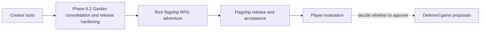

# RPG Framework Product and Release Roadmap

This roadmap prioritizes one maintained framework sample: **باغ قصه‌ها — Garden of Stories**. The original five game concepts below remain deferred product proposals. They are neither cancelled nor approved for production; Phase 9 will revisit them after flagship player evaluation. **محله مهربانی** remains an independent first-party product. Hello World, Blood Leaf, generated narrative/tactical consumers, and creator previews are developer fixtures, not additional public-facing sample games.

## Phase 6 creator workflow status

The repository now has a local creator CLI for GLB/glTF import, a versioned
shared asset catalog with technical readiness separate from game-specific
release approval, a local model preview, and a versioned one-scene project
manifest/scaffold. The independent acceptance gate generates narrative-only
and tactical-only projects outside the workspace using installed package
archives. Both are tooling fixtures, not shipped or approved games. Their
source-rendered Chromium captures are
[narrative-only](previews/creator/generated-narrative-consumer.png) and
[tactical-only](previews/creator/generated-tactical-consumer.png). These
generated consumers remain package acceptance fixtures.
The package, preview, and both generated-consumer gates passed locally on
Node.js 22.23.5/npm 10.9.9. At Phase 6 completion, its focused workflow had not
run remotely because that branch remained local; this historical CI gap is
separate from the current Phase 6.2 local acceptance. These fixtures do not
count as games.

## Phase 6.2 sample consolidation and release hardening

Garden is the only public-facing framework sample and the primary integration
consumer of `waypoint-rpg-core`, `waypoint-rpg-narrative`,
`waypoint-rpg-gameplay`, and `waypoint-rpg-three`. It retains its two existing
story outcomes, connected maps, tactical encounter, progression, and versioned
saves. Shared character-animation and cinematic-timeline contracts live in
Three; Garden owns its choreography, camera staging, and dialogue. Its public
fixtures include a small static and a genuinely rigged GLB with procedural
fallbacks. Actual source/output hashes, game-specific budgets, independent
release approvals, and private Meshy staging are checked by Garden's asset
gate. Meshy pilot output is not a public release dependency.

Technical acceptance remains independent: Hello World, the Blood Leaf scene
consumer, static/rigged GLBs, cinematic regressions, generated
narrative-only/tactical-only projects, installed tarballs, module omission,
linked watch builds, creator preview/importer, and screenshot workflows remain
under developer verification. See [SAMPLE-VERIFICATION.md](SAMPLE-VERIFICATION.md)
for owners and commands.

Local Phase 6.2 acceptance is complete: `npm run verify` passed, all 23 Garden
production browser tests passed, the linked watch and independent consumer
checks passed, and the actual Playwright screenshot set records its source
commit. The branch remains local, so no remote Actions run was triggered. The
release gate still requires an independent reviewer for each exact asset hash;
this approval belongs to Phase 8 release acceptance.

## Deferred independent game proposals

The concepts below were proposed for an earlier five-game portfolio. Preserve
their notes for future review, but do not create these applications during
Phases 6.2–8. Phase 9 will decide separately whether any should proceed. Their
prior one-map constraint was specific to that proposal and does not constrain
Garden's connected-map adventure.

| ID                                                  | Audience and session                                                         | Single-scene game, objective, and end conditions                                                                                                                                                                                     | Framework use, assets, persistence, and acceptance                                                                                                                                                                                                                                                                                                               |
| --------------------------------------------------- | ---------------------------------------------------------------------------- | ------------------------------------------------------------------------------------------------------------------------------------------------------------------------------------------------------------------------------------ | ---------------------------------------------------------------------------------------------------------------------------------------------------------------------------------------------------------------------------------------------------------------------------------------------------------------------------------------------------------------- |
| **NARRATIVE — برگ خون (proposed)**                  | Persian readers, teens and adults. 6–10 minutes.                             | In an archive courtyard, meet a keeper and choose investigation or confrontation. Inspect a clue or accept a distinct consequence, then reach one of two endings. Completion records the branch. Restart begins a fresh playthrough. | Core + narrative; no gameplay package required. Shared traveler/keeper rigs and archive props, unique leaf/inscription. Idle and inspect clips. Test both endings, clue gate, resume, restart, Persian RTL, keyboard exit, and scene lifecycle.                                                                                                                  |
| **TACTICAL — Arena of Embers (working title)**      | New tactics players, teens and adults. 8–12 minutes.                         | Equip one training kit in a single arena and complete a deterministic encounter using movement, range, and one status ability. Victory completes the session. Defeat returns to a safe retry.                                        | Core + gameplay; narrative optional. Reuse humanoid rigs, create unique kit and opponent details. Test player victory, internal enemy-action defeat, turn/reward rollback, mid-combat save, reload, and duplicate-outcome rejection. Release only after Phase 4's gameplay consumer evidence is closed.                                                          |
| **PUZZLE — Garden restoration (deferred proposal)** | Casual puzzle players and families, subject to audience review. 5–8 minutes. | Restore a water feature by exploring one connected garden, collecting tools, and activating a sequence of objects. Invalid order gives a gentle retry. Completion visibly restores the fountain.                                     | Core + narrative conditions; gameplay inventory only if the current inventory API materially reduces game-owned code. New one-map scenes and props. Test actual arrival vs reachability, ordered puzzle, state recovery, reload, touch, and keyboard. Existing Garden of Stories informs the design only; this proposal is a separate product if later approved. |
| **TRANSFORMATION — پر سوخته (proposed)**            | Short fantasy story players, teens and adults. 6–10 minutes.                 | At one hilltop sanctuary, examine symbols and choose how to restore a feather. A committed transformation changes the player presentation and opens an objective within that map. A second choice produces a distinct ending.        | Core + narrative + Phase 5 animation/timeline adapter. Unique shrine/feather and either one validated rig with supported morphs or two validated rigs. Test form transition interruption/skip/reduced motion, reload into committed form, keyboard parity, and no gameplay result from timeline cues.                                                            |
| **ACTION — آهن و ماران (working title)**            | Players comfortable with real-time input, teens and adults. 5–8 minutes.     | Cross one forge arena, evade readable hazards, and overcome a symbolic sentinel. Defeat offers a retry. A pre-encounter checkpoint restores on reload.                                                                               | Core and Phase 5 animation. Game-owned action input/enemy logic first. Reuse a humanoid base, create sentinel and forge props. Test input timing, pause/retry/checkpoint, performance, and controller/keyboard support. Consider a separate optional real-time package only after this playable consumer proves a reusable contract.                             |

Every proposal would need separate approval of its concept, audience, copy,
safety review, content ownership, map definition, persisted-state contract,
keyboard/touch design, portrait/desktop layout, release budget, browser matrix,
and real browser captures before production or release. Persian-first DOM is the
default where the story supports Persian. Text remains HTML rather than canvas
textures.

## Capability matrix and dependency order

| Capability               | Deferred narrative             | Deferred tactical                        | Deferred puzzle             | Deferred transformation   | Deferred action                                        |
| ------------------------ | ------------------------------ | ---------------------------------------- | --------------------------- | ------------------------- | ------------------------------------------------------ |
| `waypoint-rpg-core`      | Runtime, identifiers, world    | Runtime, world                           | Graph navigation            | Runtime, world            | Runtime, input state                                   |
| `waypoint-rpg-narrative` | Branches, quests, endings      | Verified battle consequence if needed    | Conditions if needed        | Choices and endings       | Optional                                               |
| `waypoint-rpg-gameplay`  | —                              | Progression, inventory, equipment, turns | Inventory only if justified | —                         | — unless a separately gated real-time module is earned |
| `waypoint-rpg-three`     | Static and rigged presentation | Rig and combat action mapping            | Static and rigged props     | Rig/morph and timeline    | Rig and action reaction mapping                        |
| Game-owned               | Story, UI, saves               | Transaction, encounter and save policy   | Puzzle rules and hints      | Form progression and save | Real-time controls and AI                              |

The immediate path is one coherent Garden adventure: grow chapter content in
Phase 7, prepare one release in Phase 8, then evaluate it in Phase 9. The
earlier concepts remain deferred proposals so they can be compared later
against player interest, framework fit, cost, and audience approval.

## Shared asset inventory and readiness

Begin with entries in **specified** status. Advance an asset through **sourced/generated → imported → validated → approved → release-ready**. A status change records reviewer, date, and evidence. Store these fields per asset: stable ID and kind; intended use and consuming games; provider/source URL or private-generation origin; creator and generation metadata where applicable; license text, commercial/redistribution rights, attribution and review; private original and release output paths; SHA-256; pinned conversion tool/version/options; scale/orientation/bounds; geometry, texture, memory, skeleton, morph and clip data; tested fallback; readiness status and reviewer.

| Shared inventory                                                                                                                                 | Garden flagship inventory                                                                                                                                    |
| ------------------------------------------------------------------------------------------------------------------------------------------------ | ------------------------------------------------------------------------------------------------------------------------------------------------------------ |
| Reusable validated character rigs and clips; ground/foliage modules; props; material/light presets; locally bundled fonts and interface symbols. | Chapter-specific maps and NPC variants, story objects, encounter assets, conditional scene objects, static/rigged GLBs, and approved fallback presentations. |

Deduplicate assets by visual use and hash before commissioning variants. Keep licensing requirements game-specific. Privately owned generated models must retain their actual ownership/usage terms and must never be labeled CC0 without evidence. Import has no paid API, account, or cloud requirement. Preserve original sources, rights evidence, generated metadata required by provider terms, optimized outputs, and conversion records in approved storage. Meshy, Quaternius, Kenney, Poly Haven, Blender, and other sources are candidates, subject to an asset-by-asset license and visual review.

No paid generation sprint is scheduled. Any later asset work must record
ownership and rights, preserve originals, use the read-only GLB inspector and
asset budgets, and remain optional to the framework.

## Game creation, releases, and evaluation

Garden's extensible, game-owned content structure identifies connected maps,
chapters and quest chains, NPC definitions, dialogue and consequences,
inventory, equipment, abilities, tactical encounters, cinematic sequences,
conditional scene objects, asset mappings, localization, and accessibility.
Chapter membership derives from existing save-compatible world state. The
gameplay and narrative packages remain optional to other consumers. Continue to
validate package independence with the generated narrative-only and
tactical-only consumers, installed tarballs, module omission, and no private
source imports.

Phase 8 accepts one Garden release only after a complete playthrough of both
story outcomes, compatible save/resume/reset behavior, isolated production
build, approved rights and game-specific model budgets, animation fallbacks,
render/memory budget, input/accessibility checks, real browser screenshots,
lifecycle/corruption recovery, deployment smoke, and release notes. Keep
Mahalle's deployment, storage, and existing four-shard Playwright workflow
independent. Any later game proposal needs its own approval and release gates.

Capture Garden from its actual production build with deterministic gameplay
state and record its source SHA, browser/WebGL configuration, viewport,
dimensions, and PNG hashes. The public README gallery shows Garden and Mahalle;
technical consumer captures stay in developer documentation and existing
workflow artifacts. Update the generated gallery only after screenshot
provenance checks pass. The historical screenshot workflow formatting failure
from run `45018058155` remains a separate baseline issue.

Start flagship evaluation without telemetry. Use voluntary ratings, written
feedback, and supervised observations appropriate to the approved audience.
Completion/replay aggregates need explicit consent and audience review. Do not
collect personal data from children. Separate player interest from developer
interest in framework technology. After a four-week trial, or longer when
evidence is sparse, record whether Garden should continue, be revised, or stop
as a maintained sample. Then evaluate each deferred proposal independently as
Continue, Revise, Defer, or Stop based on player demand, audience review,
framework fit, cost, and ownership readiness. Preserve playable demos and
document evidence limits.

## Parallel workstreams and integration ownership

| Workstream             | Owns                                                                        | Handoff contract                                                                |
| ---------------------- | --------------------------------------------------------------------------- | ------------------------------------------------------------------------------- |
| Framework architecture | Package boundaries, public contracts, API review                            | Versioned contract note, consumer proof, compatibility review                   |
| Asset and animation    | Import validation, fixture ownership, Three.js adapter, animation lifecycle | Validated asset IDs, fixture/license record, budgets, lease/disposal behavior   |
| Creator tools          | Import CLI, shared catalog, preview, template                               | Versioned manifest, commands, sample consumer fixture                           |
| Garden expansion       | Chapters, maps, game-owned content and presentation                         | Complete chapter loop, compatible persistence, fallback and acceptance evidence |
| Integration and QA     | Browser tests, rendered previews, performance, deployment checks            | Exact commands, browser/device matrix, artifacts and failure classification     |

Garden content work owns only Garden-local definitions and presentation.
Architecture owns package contracts and root workspace manifests/lockfile.
Release QA owns shared workflows and gallery generation. Documentation
integration owns the canonical roadmap and generated README. Preserve worktree
ownership, coordinate shared-file changes, and keep each milestone focused.

## Proposed GitHub milestones and issues

These are drafts for later issue creation. No remote issues are part of the current documentation task.

| Milestone                | Issue breakdown                                                                                                                                                                                                                  |
| ------------------------ | -------------------------------------------------------------------------------------------------------------------------------------------------------------------------------------------------------------------------------- |
| Phase 4 evidence closure | Standalone gameplay archive + Node 22.0 runtime gate; combined scene consumer with gameplay; transaction rollback and retry integration proof; gameplay save/resume gate. Record what is actually missing before implementation. |
| Phase 5 reference        | P5.0 contracts/baseline; P5.1 local import/validation; P5.2 independent animation instances and ownership; P5.3 cancellable timeline; P5.4 browser and screenshot acceptance.                                                    |
| Phase 6 creator workflow | Offline CLI; catalog schema/readiness; local preview; manifest/template; installed-tarball narrative and tactical template consumers.                                                                                            |
| Phase 6.2 consolidation  | Garden integration, Three.js public animation/timeline API, release budgets and approvals, private staging, fixture audit, docs and production screenshots.                                                                      |
| Phase 7 flagship RPG     | Expand Garden chapter structure, connected maps, quest chains, NPCs, narrative consequences, gameplay, conditionals, accessibility and compatible persistence.                                                                   |
| Phase 8 flagship release | Approve Garden rights and budgets; complete both outcomes, save/lifecycle/accessibility/performance gates; capture real screenshots; smoke the isolated release.                                                                 |
| Phase 9 evaluation       | Evaluate Garden with privacy-conscious player feedback; decide whether deferred independent proposals merit production.                                                                                                          |

The Phase 5 asset-animation prototype and Phase 6 creator workflow remain
historical completed milestones with their evidence intact. Phase 6.2
consolidation is complete locally; Phase 7 is next. Do not begin Phase 7
content production as part of this task, create remote issues, deploy, publish,
or request a paid subscription.
