# باغ قصه‌ها — Garden of Stories

Garden of Stories is the repository's single flagship framework sample: a
family-friendly Persian 3D RPG built on the independently packaged
`waypoint-rpg-core`, `waypoint-rpg-narrative`, `waypoint-rpg-gameplay`, and
`waypoint-rpg-three` packages. Choose to help a gardener restore a tree or
follow a clue to a friendly guardian's tactical light game. Both paths change
the garden and lead to a positive ending with a Garden-owned cinematic.

The game runs in a browser without a backend, account, analytics, or runtime
external API. Its RTL interface is DOM-based, including dialogue, inventory,
quest status, combat controls, and endings. Saves use a Garden-only key and do
not access the Kids RPG's IndexedDB profiles or the scene demo's storage.

## Real production screenshots

`npm run sample:garden:previews` drives the production build in Chromium with
software WebGL. `provenance.json` records the source commit, dimensions, and
SHA-256 for every image. Captures document real game states; they are not
pixel-perfect regression baselines.

| Capture                 | Screenshot                                                                                                 |
| ----------------------- | ---------------------------------------------------------------------------------------------------------- |
| Title                   | 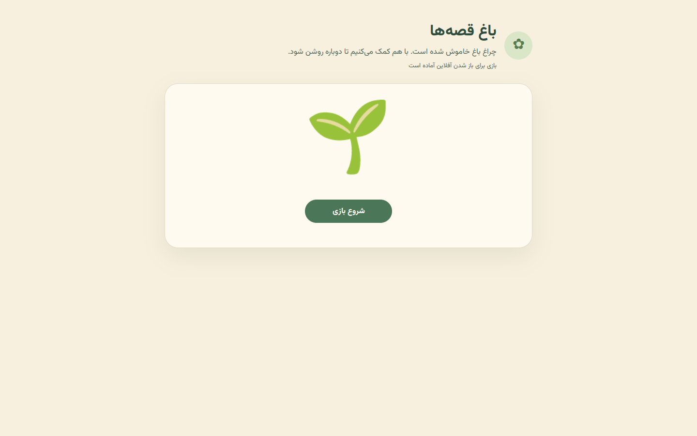                              |
| Village                 | 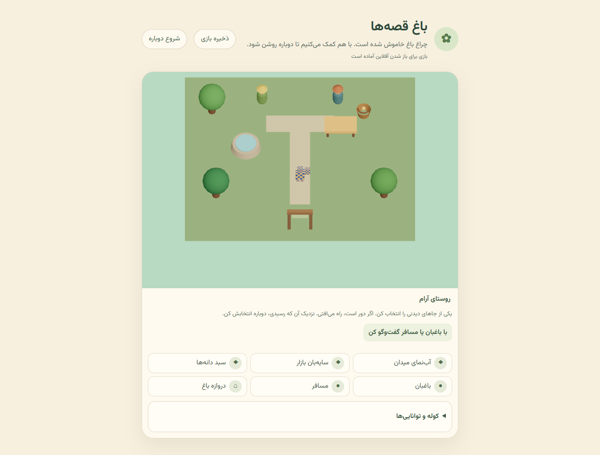                           |
| Persian dialogue        | 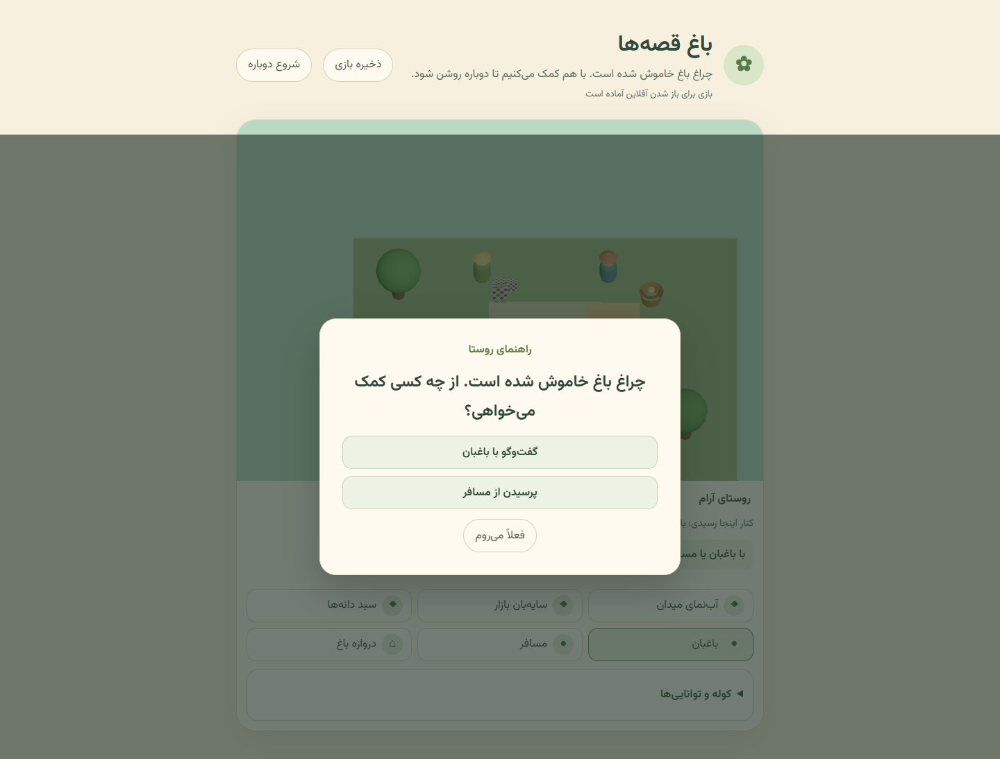                                 |
| Inventory and equipment | 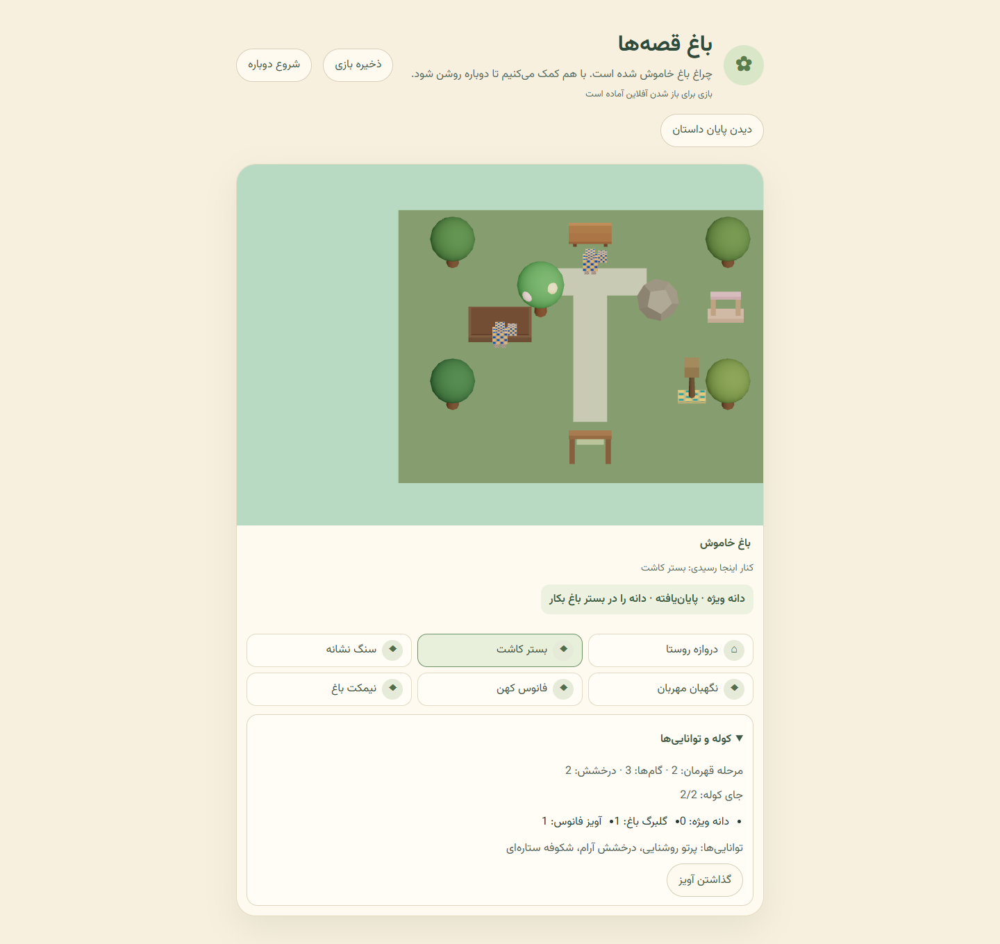                          |
| Garden before           | 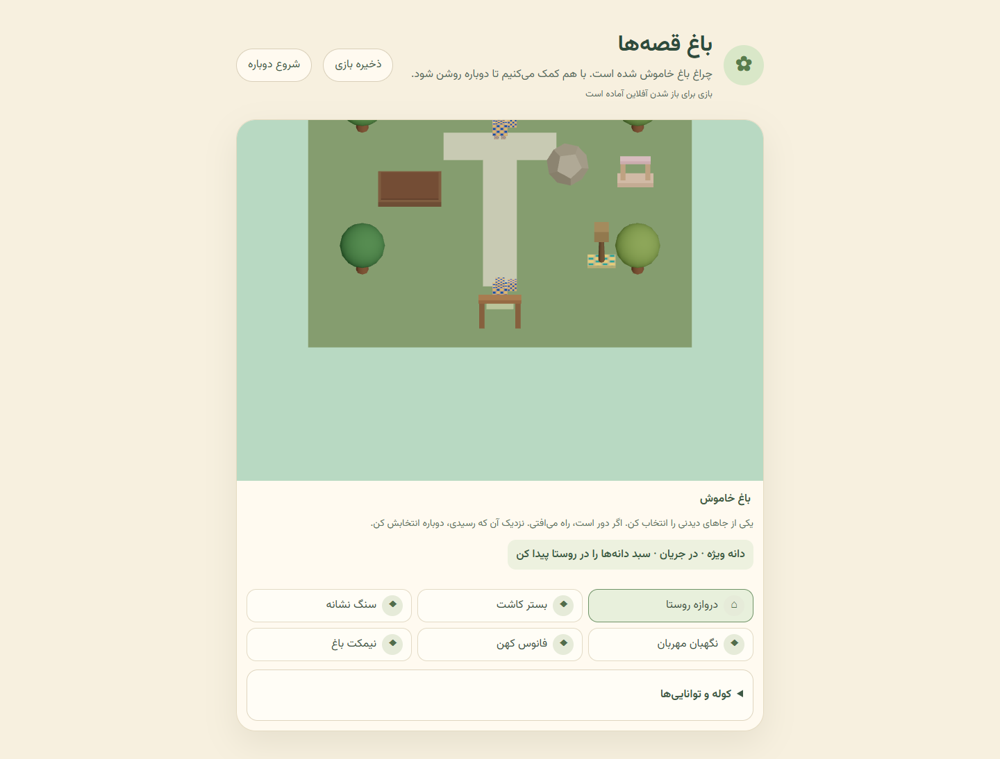                    |
| Gardener outcome        | 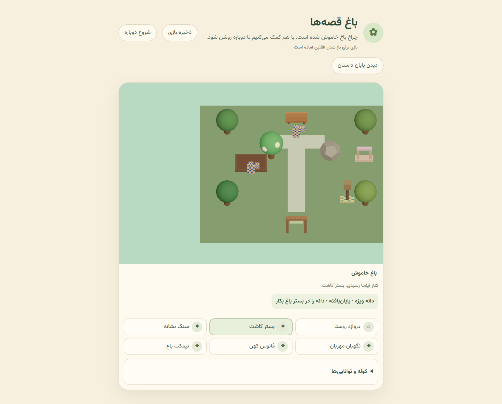                  |
| Tactical battle         | 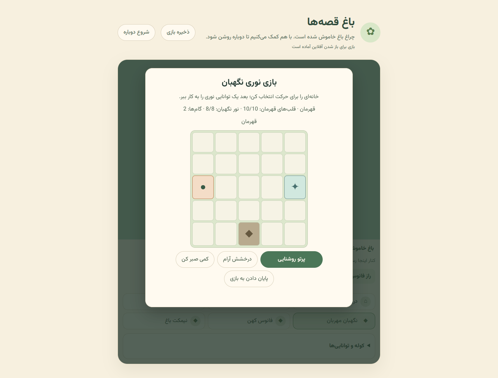                |
| Ability effect          |  |
| Guardian outcome        | 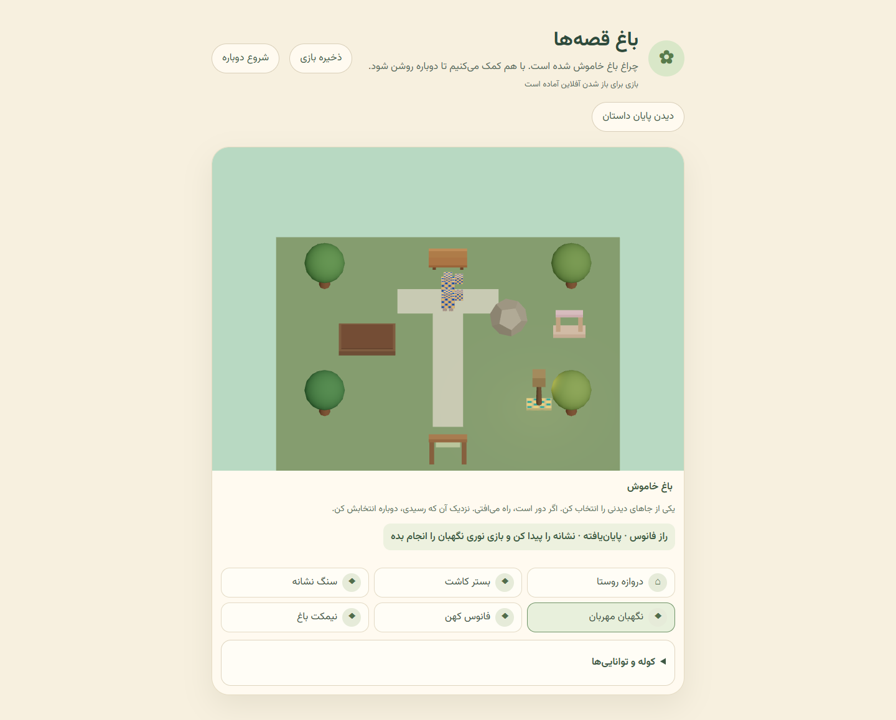      |
| Story ending            | 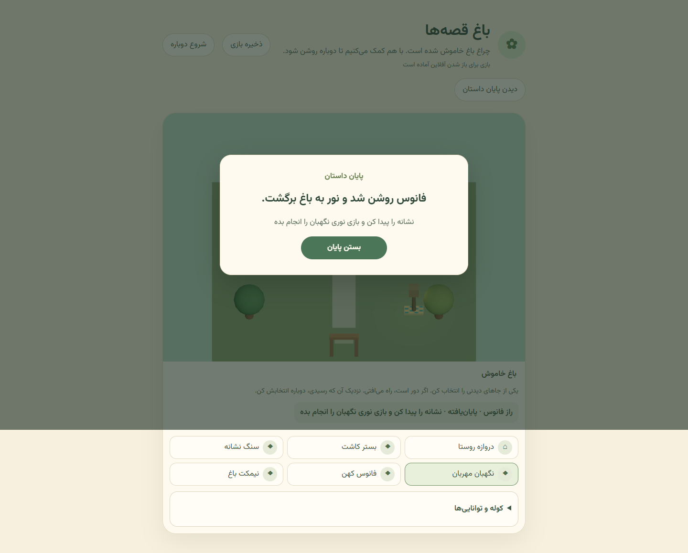                                |
| Portrait layout         | 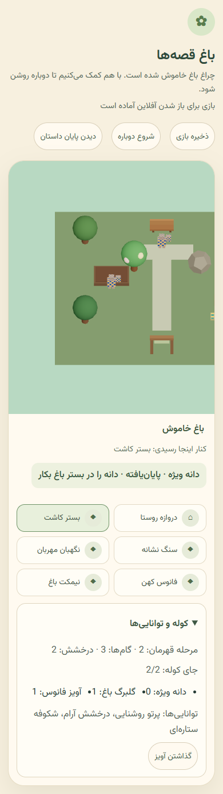                            |
| Restored save           | 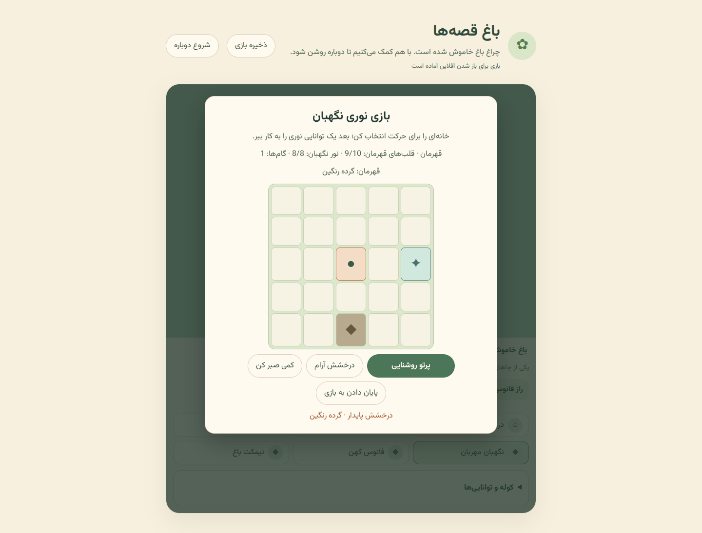                             |

## Architecture

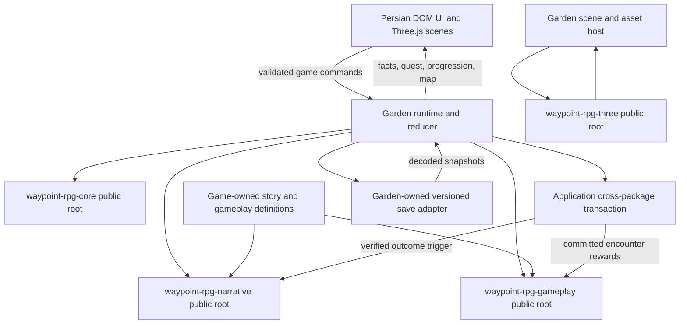

### Core runtime and world navigation

The application composes `createGameRuntime<GardenState, GardenCommand>` with
one pure reducer. `waypoint-rpg-core` provides the runtime, graph traversal,
`findPath`, and world types. Garden owns scene registration, map and target
ownership, path movement, arrival commits, interaction range, and the
`ARRIVE`/transition rules. A reachable path does not count as an arrival: the
reducer verifies each committed waypoint before the player can interact.

The village contains a fountain, market shelter, gardener, traveler, seed
basket, and the garden gate. The garden contains the planting bed, hidden clue,
ancient lantern, guardian, and return gate. `src/scenes/registry.ts` validates
the map/graph pairings. A single demand-rendered R3F canvas loads the selected
scene, and the sample-owned camera, probe, and scene components dispose their
listeners on unmount. During movement the player is rendered toward the next
route anchor while the reducer retains its last committed anchor. The scene
probe observes the player at that destination across consecutive frames, with a
render between observations, before asking the runtime to dispatch `ARRIVE`.
The runtime rechecks the map, playthrough, route, next index, and committed
anchor; stale callbacks after reset or scene replacement cannot advance state.
This keeps arrival synchronized to rendered motion without a wall-clock timer.
Camera and rendered consequence probes are used by browser checks. The visible
tree and warm lantern lighting are projections of committed narrative facts.

The scene combines Garden-owned procedural fallbacks with two locally bundled,
hash-verified GLB fixtures: a textured static landmark and a genuinely rigged
character with four original clips. The bundled fixtures are unchanged
repository-authored MIT synthetic assets; no private Meshy pilot output is
included. Model records, rights, source hashes, measured geometry, and Garden
budgets are in `assets/`. `sample:garden:asset-check` inspects actual source and
runtime bytes, measurements, mappings, and per-map budgets. Release requires
separate approval evidence for each exact output hash. Landmark placement uses
object transforms; imported geometry, attributes, textures, rigs, and poses are
not modified.

`src/models/GardenModel.tsx` loads assets through the public Three package and
owns each scene instance's lease. The hero, traveler, and guardian select
semantic idle, move, interaction, and combat states independently. Shared
animation blending, interruption, reduced-motion poses, loading cancellation,
and cleanup live in `waypoint-rpg-three`. Missing or rejected assets leave the
existing procedural characters and landmarks visible.

### Chapter content and cinematics

`src/content/adventure/catalog.ts` is the extensible Garden-owned index for
connected maps, chapters, quest alternatives, NPC and dialogue IDs, inventory,
equipment, abilities, encounters, cinematic IDs, conditional scene objects,
asset bindings, locale, accessibility, and persistence mapping. The current
chapter spans the village and garden. Chapter membership derives from the
already-saved map ID, so the version-2 save format remains unchanged.

`src/presentation/ending-cinematic.ts` defines game-specific camera and
character choreography for each existing ending. The Three package validates
and runs the timeline; Garden decides when a committed story outcome requests
it and presents the existing Persian dialogue. Timelines are transient,
cancellable, and are not replayed after save restoration. Reduced motion keeps
the ending meaning and dialogue while skipping camera movement and using a
static semantic pose.

### Narrative and gameplay packages

`src/content/story.ts` authors stable dialogue, choice, quest, fact, trigger,
and ending IDs. The runtime uses `validateNarrative`, `compileNarrative`,
`createNarrativeState`, `transitionNarrative`, `getDialogueView`,
`getQuestStatus`, `getFact`, and `decodeNarrativeState` through the public
narrative root. Persian interface copy is in `src/content/fa/ui.ts`.

`src/content/gameplay.ts` owns the hero and guardian definitions, attributes,
resources, three items, charm equipment, abilities, temporary statuses, 5×5
board, encounter, enemy policy, outcome mapping, and bounded victory reward.
The application uses `validateGameplay` in sample tests and
`compileGameplay`, `createGameplayState`, `transitionGameplay`,
`applyGameplayGrant`, `getCharacterLevel`, `getCharacterAttributes`,
`getEffectiveCharacterAttributes`, `getUnlockedAbilityIds`,
`getInventorySlotCount`, `encodeGameplayState`, and `decodeGameplayState` via
the gameplay package root. UI renders those selectors and transition results;
it does not simulate turns, derive equipment modifiers, grant rewards, or
change quests.

Path A grants one special seed, consumes it at the planting bed, completes the
gardener quest, grants experience and two items, equips the charm, and grows a
blossom tree. Path B requires the traveler's clue before the guardian can be
challenged. The gameplay package owns movement validation, turn ownership,
range/resources, deterministic enemy turns, status effects, terminal outcome
markers, replay checks, and victory rewards.

### Cross-package combat transaction

`applyBattleAction` in `src/game/runtime.ts` owns the trusted transaction. It
checks map, playthrough, gameplay revision, and encounter-instance identity,
then passes the intent to `transitionGameplay`. For a terminal result it
verifies the gameplay package's committed outcome marker against the authored
encounter mapping, maps only that known consequence to a pre-authored narrative
trigger, and runs `transitionNarrative` with its current revision. The reducer
commits the resulting gameplay and narrative snapshots together only if both
accept the result. A rejected trigger returns the original combined state.
The UI cannot dispatch internal enemy decisions, reward grants, or arbitrary
story triggers.

Winning illuminates the ancient lantern and completes the lantern quest.
Withdrawal or an exhausted challenge produces a gentle retry message and keeps
the quest available. The two victories have different visible world facts and
ending text; defeat is not punitive.

## Save architecture

`src/persistence/garden-save.ts` owns the isolated
`waypoint-rpg:garden-adventure:save` key and a strict version-2 envelope with
the current map/anchor, shared playthrough identity, narrative snapshot, and
the gameplay package's encoded snapshot. Both package decoders run before
restore, and the adapter rejects inconsistent story facts, rewards, encounter
markers, or map/anchor pairs. Version-1 narrative-only Garden saves are
migrated using bounded gameplay grants.

New game, save, continue, active-combat reload, completed-story reload, reset,
corrupt/future-version recovery, and storage exceptions are supported. Invalid
bytes remain untouched until explicit reset; an unavailable storage session
can still be played without saving. Storage code remains outside package
reducers and the narrative/gameplay libraries.

## Build, play, and test

Use the repository's pinned Node 22 and npm 10 toolchain from the repository
root:

```bash
npm ci
npm run sample:garden:dev
npm run sample:garden:preview
npm run sample:garden:build
npm run sample:garden:test
npm run sample:garden:e2e
npm run sample:garden:asset-check
npm run sample:garden:release:check
npm run framework:garden-consumer
```

The browser suite runs both existing endings, the complete gardener and
guardian paths, cinematic cancellation, restoration without replay, fallback,
and a mid-combat reload. The independent consumer gate packs all four compiled
libraries, copies Garden outside the checkout, installs each archive offline,
verifies root-only ESM and declarations in NodeNext and Bundler modes, then
type-checks, unit-tests, builds, and launches Chromium against that install.
Development-tool installation is separate from offline archive installation.

To capture the twelve screenshots from the production app, install Chromium
once and run:

```bash
npx playwright install chromium
npm run sample:garden:previews
```

The capture waits for a live canvas, orthographic camera, populated scene,
active map, and rendered world consequence. It checks each PNG's signature,
dimensions, size, and hash before writing the source-commit provenance manifest.
The `sample-previews.yml` workflow uploads the public game captures. The
developer fixture guide documents separate framework and creator screenshots.

## Known limits

- Chromium software-WebGL is verified; other browsers and physical touch
  devices remain unverified.
- The two included synthetic GLBs are technical sample assets, not a completed
  production art direction. Private Meshy pilot models remain isolated and
  require game-specific rights approval before any release use.
- The current chapter has two connected maps and one deterministic friendly
  tactical challenge. Future chapter production, crafting, and multiplayer are
  outside this consolidation phase.
- Vite reports the expected large Three.js bundle warning in this small sample.
