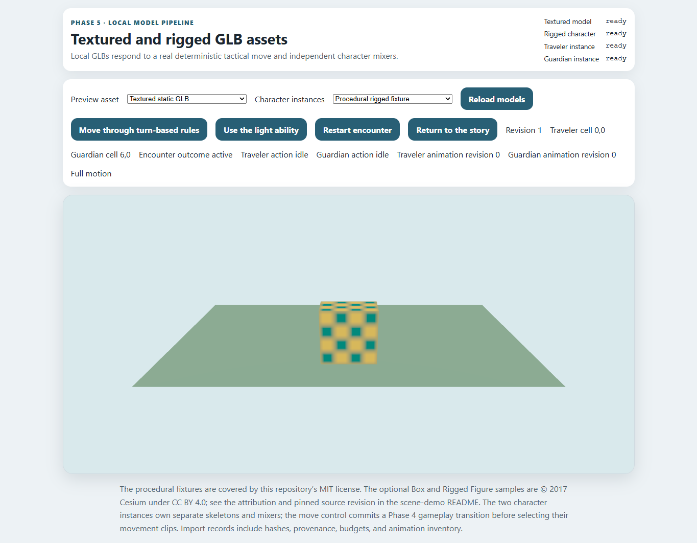
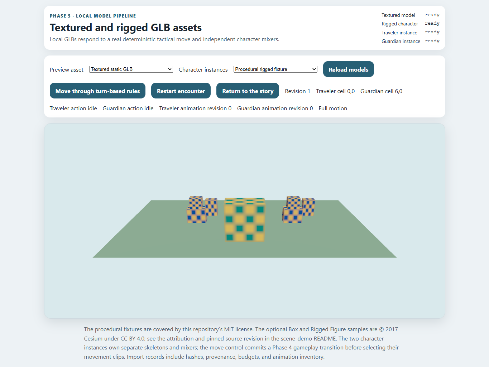
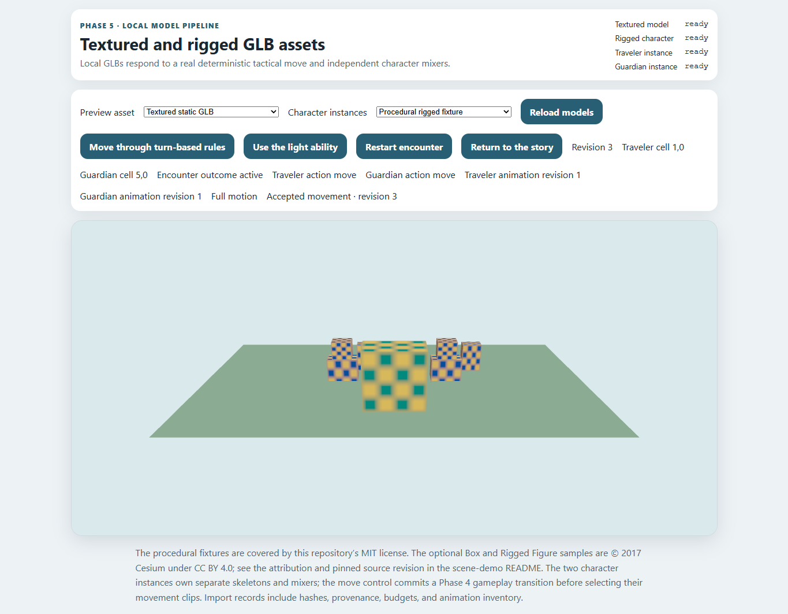
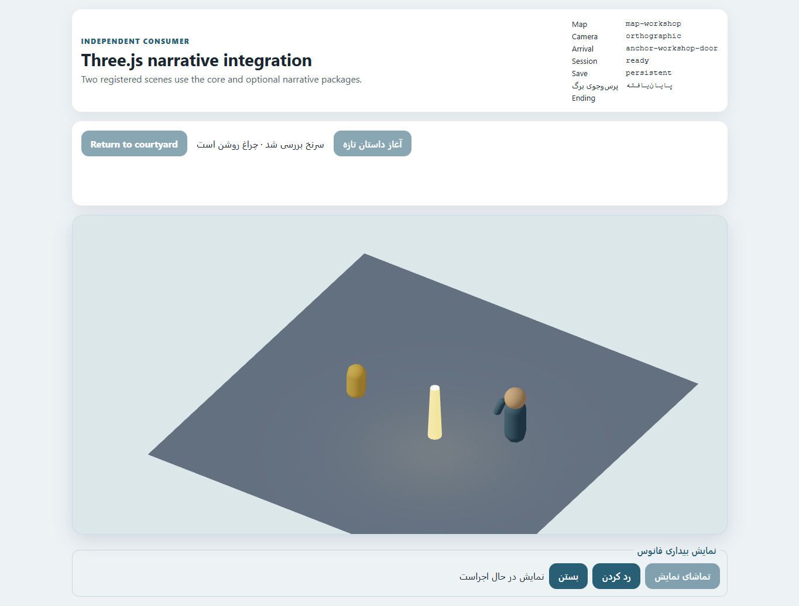
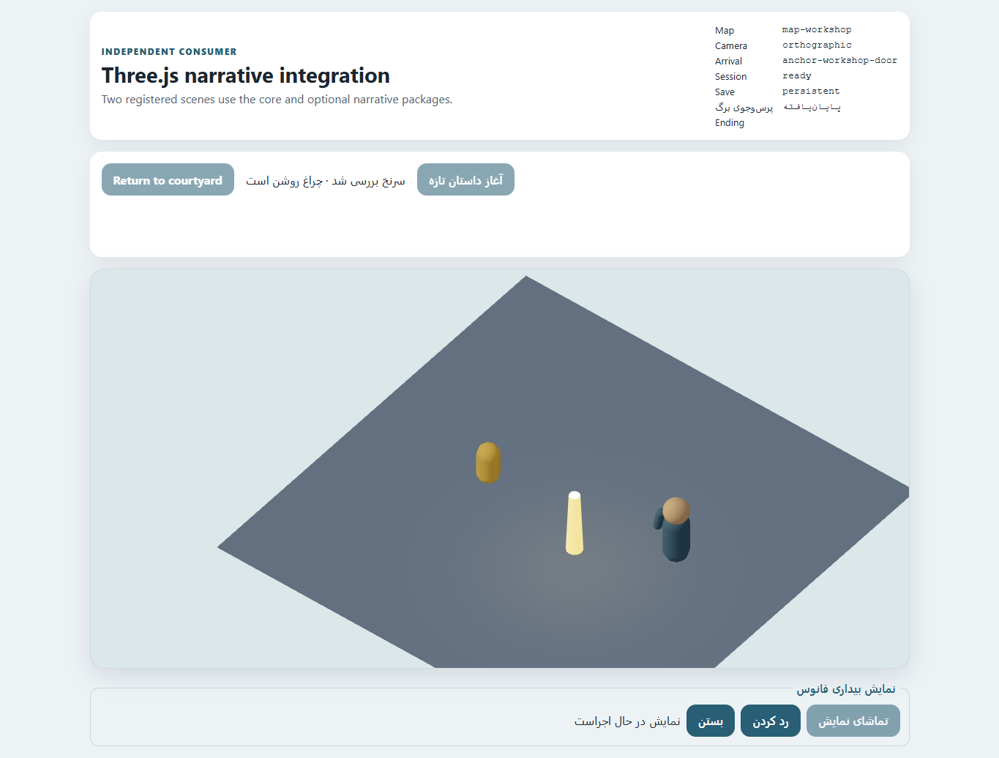
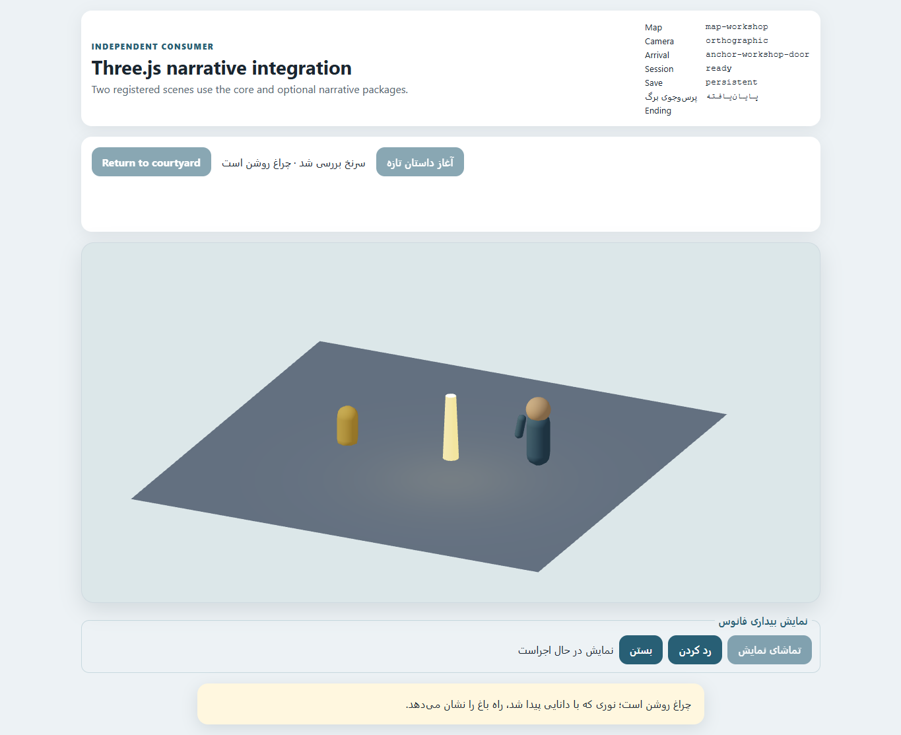
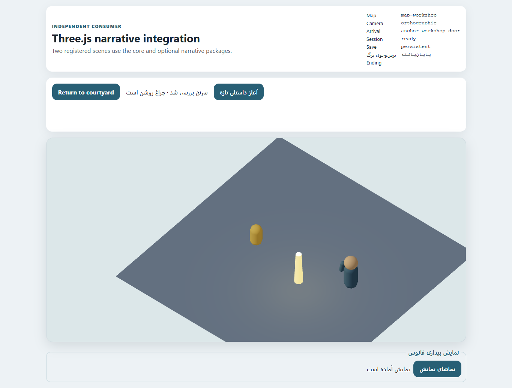
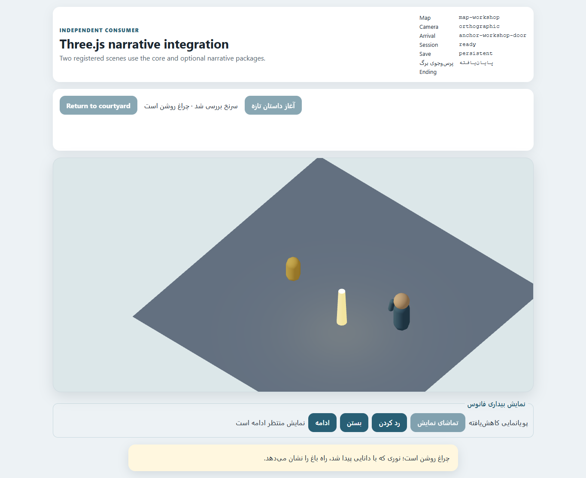
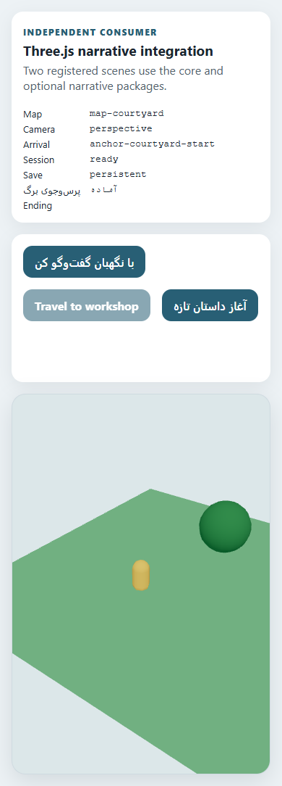

# Developer verification fixture: Blood Leaf and Three.js consumer

This remains a technical acceptance consumer, not a public-facing sample game.
The public sample gallery presents Garden of Stories; the root Mahalle game
remains its separate first-party product. Keep this fixture while it owns
unique narrative, transaction, scene-lifecycle, model, and cinematic checks.

This example validates three optional public packages in a separate Three.js
game: `waypoint-rpg-core` for generic runtime/world primitives,
`waypoint-rpg-narrative` for deterministic dialogue/quest transitions, and
`waypoint-rpg-gameplay` for progression and tactical combat. The example does
not import Kids RPG source. Its scene registry, `SceneHost`, cameras, R3F
scenes, DOM dialogue/encounter UI, persistence, movement/interaction policy,
and authored Persian content remain application-owned.

The original fictional story, **برگ خون — The Blood Leaf**, offers two choices
with different facts and quest outcomes, condition-restricted endings, a
condition-checked lantern interaction, a persistent workshop consequence, and
(on the vengeance path) a courtyard guardian trial that maps combat outcomes
back to narrative triggers through an app-owned transactional adapter. The
Persian UI is DOM-based and RTL.

## Run and verify

Use the repository toolchain: Node.js `>=22.22.2 <23` and npm `>=10 <11`.

```bash
npm run framework:watch
npm run framework:watch:check
npm --prefix examples/scene-demo run typecheck
npm --prefix examples/scene-demo run test
npm --prefix examples/scene-demo run build
npm --prefix examples/scene-demo run test:e2e
npm run framework:scene-consumer
```

`framework:watch` builds/watches both workspace libraries, waits for their
first successful outputs, then starts the scene-demo's Vite server. It uses
Vite's default linked-package resolver. The check edits both packages while
Vite is running, verifies default source reload, preserves the last good
output on a TypeScript error, and checks recovery after the source is restored.

`framework:scene-consumer` copies this example outside the monorepo, installs
the locked development tools, packs the core/narrative/gameplay libraries,
installs those local tarballs with npm offline, then typechecks, runs unit
tests, builds with Vite, and launches the Chromium narrative/lifecycle smoke.
Development-tool installation (`npm ci`) is a separate network/cache operation
from installing the library tarballs from local files.

The core, narrative, and gameplay packages declare a Node.js `>=22.0.0`
runtime floor and have no runtime dependencies. Root build/test tooling
requires Node.js `>=22.22.2 <23` and npm `>=10 <11`. Browser execution is
validated in Chromium; this does not claim support for every browser or
physical device. The production Vite build may report a large Three.js bundle
warning.

## Save and scene ownership

The demo owns a separate localStorage envelope (schema version 2), including
story ID, content and structural compatibility versions, narrative snapshot,
optional gameplay snapshot, committed map, and entry anchor. Phase 3 schema v1
saves migrate in memory. Missing gameplay materializes a fresh playthrough
aligned to the narrative playthrough ID. Copy-only content-version changes
remain loadable; incompatible structure or corrupt/unsupported bytes are
preserved for explicit recovery. A recovery session is session-only. A
confirmed reset invalidates pending work; when storage cannot be cleared,
autosave stays off so the new session cannot overwrite the preserved old bytes.

Startup validates stored state before the host restores its map at the saved
anchor. `SceneHost.start(mapId, entryAnchorId?)` keeps the default spawn
behavior and accepts only a known walkable anchor on that map. The game saves
a destination only after the scene load commits. Scene registration,
transitions, load cancellation, cleanup of scene-level resources, two camera
modes, and the demand-rendered canvas remain owned by this example. Verified
model loading, animation controllers, and timeline validation/player come from
the optional `waypoint-rpg-three` public package root.

## Shared Three.js model, animation and timeline fixture

Open `/?phase5=assets` in the scene-demo to load one repository-authored
textured static GLB and one textured skinned GLB with four named clips. Both are
synthetic fixtures under the root MIT license and load from this example's
own `public/models/` directory. The preview is isolated from the Blood Leaf
story and the Kids RPG; it makes no network requests for model data.

Verified model loading, independent character-animation controllers and
timeline validation/playback are imported from the public
`waypoint-rpg-three` package root. Game-specific clip mapping and cinematic
staging remain in this fixture; Garden owns and exercises its own choreography.

The runtime preview also loads two pinned, third-party source models from the
Khronos glTF Sample Assets repository: **Box** and **Rigged Figure** at commit
`e124e8d8d7330a5372bc2b4d00d39a4a9d7997ea`. Both are © 2017 Cesium and licensed
CC BY 4.0, with “Cesium for Everything” attribution. The model-specific
license records and upstream links are stored beside the source GLBs in
`fixtures/model-source/khronos/`; generated source/output hashes and normalized
runtime records are in `src/animation/asset-records.json`. These local-only
fixtures do not enter the Kids RPG registry or PWA precache.

From the repository root, `npm run sample:phase5:previews` builds the production
consumer and captures nine real Chromium states. `npm run
sample:scene:previews` captures both the Blood Leaf gallery and these Phase 5
screenshots. The script waits for committed scene readiness, model loading, or
timeline events instead of using fixed sleeps. It checks WebGL frames, image
signatures, dimensions, and minimum file size. The provenance manifest records
the source commit, viewport, Chromium version, fixture hashes and licenses,
measured model size/triangle/texture/joint/clip data, load durations, observed
renderer memory, five warmed scene round trips, and each PNG's SHA-256 under
`docs/previews/phase5/`.

| Capture                                                                                          | Production-rendered state                        |
| ------------------------------------------------------------------------------------------------ | ------------------------------------------------ |
|                          | Textured static GLB                              |
|     | Independent skeleton instances                   |
|  | Gameplay-driven movement                         |
|        | Registered interaction action                    |
|                       | Lantern camera staging                           |
|               | Accessible RTL DOM dialogue                      |
|    | Lantern rendered from a committed narrative fact |
|                  | Dialogue and continuation remain available       |
|                      | 390×844 viewport                                 |

To regenerate the source fixtures and import them into the demo, run from the
repository root:

```sh
node examples/scene-demo/scripts/generate-phase5-fixtures.mjs --check
npm run models:import -- --source examples/scene-demo/fixtures/model-source/static-textured.glb --metadata examples/scene-demo/fixtures/model-source/static-textured.asset.json
npm run models:import -- --source examples/scene-demo/fixtures/model-source/rigged-animated.glb --metadata examples/scene-demo/fixtures/model-source/rigged-animated.asset.json
npm run models:import:test
npm run example:scene-build
npm --prefix examples/scene-demo run test:e2e
```

The importer is a development tool, not a runtime dependency. It accepts local
GLB or glTF 2.0; output is self-contained GLB. Local glTF sidecars must remain
inside their source folder. The current allowlist supports core PBR material
data, embedded PNG/JPEG textures, skinning, morph targets, and named clips; it
rejects unconfigured compression and texture extensions with diagnostics.
Blender/FBX/OBJ conversion, retargeting across different skeletons, and a
general-purpose asset editor remain future work.

At runtime the example loader accepts only self-contained GLB 2.0. It inspects
the container before Three.js parsing and rejects external buffer or image
references; the importer packages an approved glTF source and its local
dependencies into that single runtime file. Each `ModelInstance` owns a
skeleton clone, animation mixer, and resource lease. Semantic `idle` actions
play a bounded two-cycle loop for demand rendering; movement, interaction, and
combat are one-shots that settle back to idle, while defeat may hold its final
pose. Reduced motion applies a static final pose and stops frame invalidation.
Changing an instance's asset ID removes the old model immediately while the new
lease loads, so released resources are never rendered.

The timeline lives under `src/presentation/` and remains private to this
consumer. `compileTimeline` validates a versioned JSON-compatible definition
against registered camera, actor, dialogue, effect, and audio IDs. It rejects
invalid references, duplicate IDs, non-finite camera values, bad cue ordering,
unbounded durations, and conflicting ownership. Authored cues are data only;
they cannot run JavaScript or mutate narrative/gameplay state.

`createTimelinePlayer` exposes deterministic `play`, `skip`, `cancel`,
`replay`, `resolveWait`, `advance`, and `dispose` operations. Every playback
gets a new execution ID, and stale callbacks are ignored. Skip completes
presentation cues but never accepts a wait or player choice on its own. The
lantern sequence uses an explicit continue wait; any future game choice must
still pass through the existing command boundary. Durable lantern state is
committed by the narrative runtime before the timeline is offered.

`CinematicStage` temporarily owns camera and input leases and releases them on
completion, skip, cancel, unmount, or context invalidation. It restores the
prior camera, clears transient light and animation cues, stops its local Web
Audio oscillator, and returns focus to the opener (or the main landmark if the
opener disappeared). Reduced motion skips decorative interpolation, while
the Persian dialogue and explicit continue control remain. The sound is a
short local oscillator cue; no remote audio or asset service is used.

The browser smoke uses Chromium with headless SwiftShader. Its renderer-memory
measurements apply to that environment only; this demo has not been certified
on physical mobile GPUs or other browsers.
